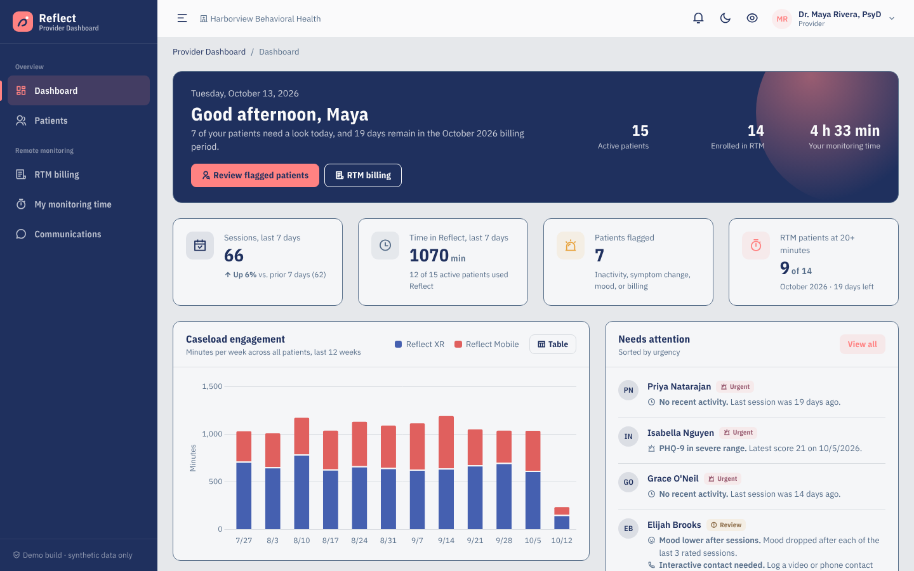
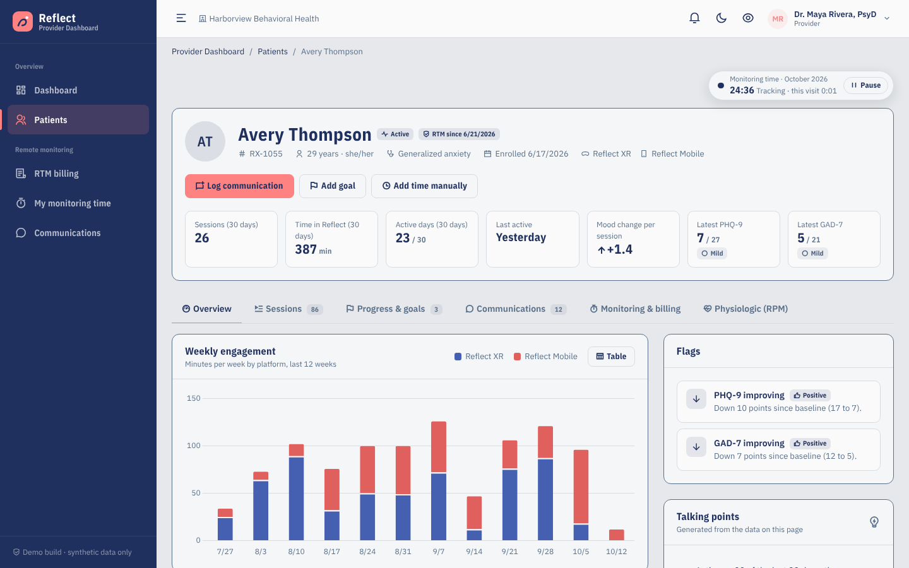
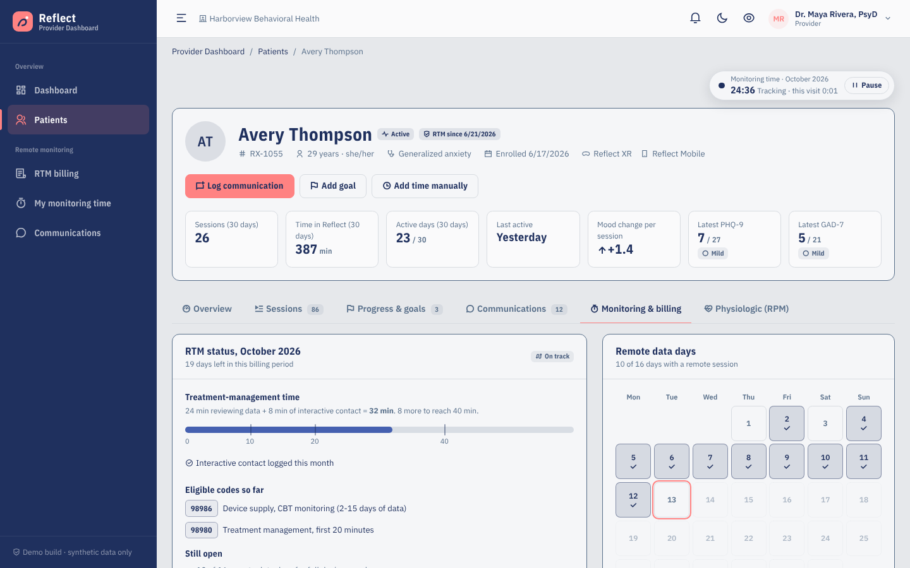
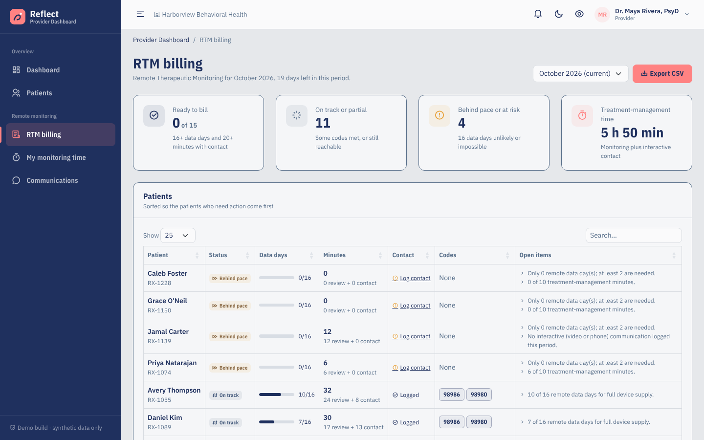
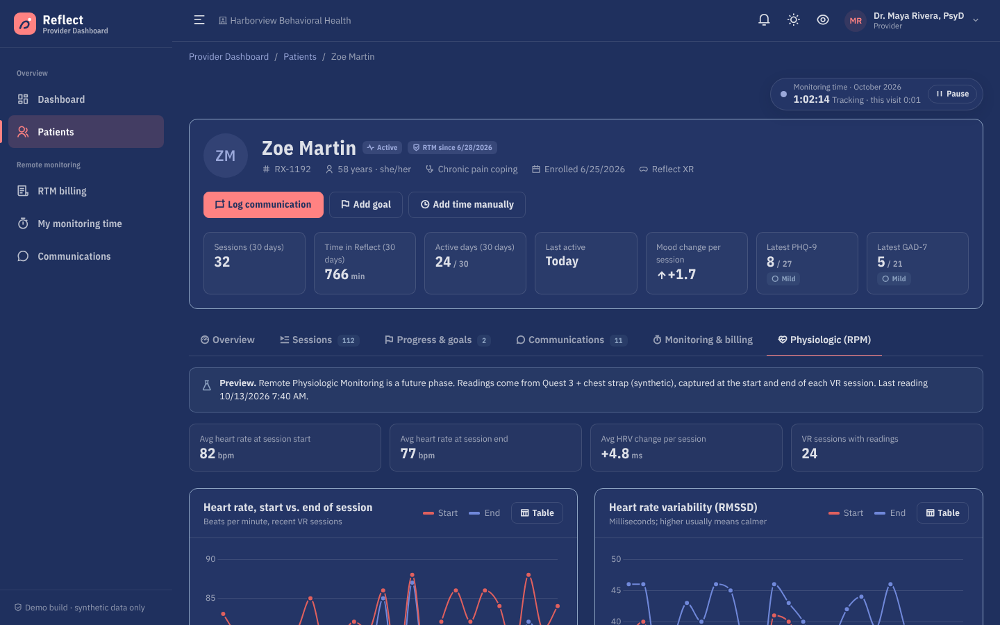
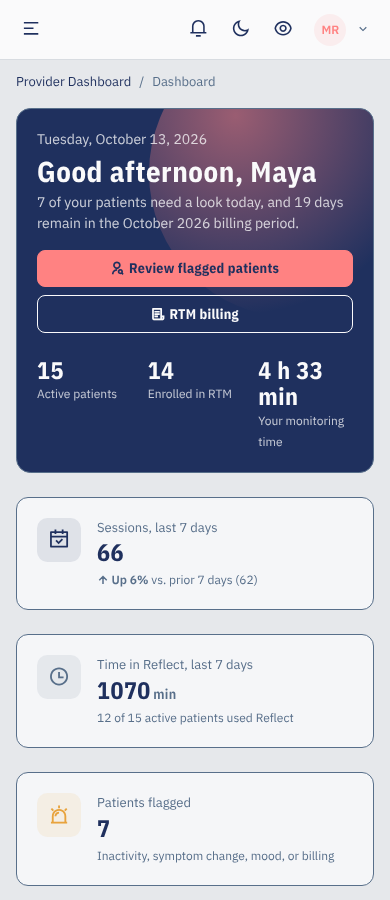

# Reflect Provider Dashboard

A prototype provider-facing dashboard for **Reflect XR** (VR) and **Reflect Mobile**, built for Persistent Technology's Challenge X.
It gives mental-health providers a longitudinal view of each patient's engagement, mood, and symptom measures, and it
records the provider's own monitoring time so **Remote Therapeutic Monitoring (RTM)** can be documented and billed.

> All patients, providers, and values are **synthetic**. Nothing here is real patient data. Not for clinical use.

It's built as a Reflect XR **extension**, following the *Tech Spec for Extension Teams* (v1.12.4): .NET 10 MVC + Razor,
jQuery, Bootstrap 5.3.3, one new Area, repository interfaces with in-memory implementations, and stand-ins for the shell
and shared services. Merging it into the main app should be mostly a file copy.

| Caseload dashboard | Patient record |
|---|---|
|  |  |
| **RTM status, data days and minutes** | **RTM billing** |
|  |  |
| **Physiologic (RPM) preview, dark mode** | **Phone** |
|  |  |

## Run it

Requirements: the .NET 10 SDK. You don't need a database, secrets, or network access.

```bash
dotnet build
dotnet run --project src/Reflect.Web
# open the URL printed in the console (for example http://localhost:5000)
dotnet test            # 58 xUnit tests for the billing, engagement, goal, and timing rules
tools/check-remixicons.sh   # verifies every icon class exists in RemixIcon v4.2
```

The synthetic caseload is generated at startup, relative to today's date, so the dashboard always looks current.
Changes you make (goals, communications, monitoring time) last until the app restarts.

**Test users.** Switch users from the profile menu (top right):

| User | Role | What you see |
|---|---|---|
| Dr. Maya Rivera, PsyD | Provider | 16 patients (default) |
| Jordan Okafor, LCSW | Provider | 6 different patients; Maya's patients return 404 |
| Sam Taylor | End User | Access denied (shows the policy works) |

## Screens

All screens live in the `Provider` Area and are protected by the `ProviderOnly` policy.

| Screen | URL | What it does |
|---|---|---|
| Dashboard | `/Provider/Dashboard/Index` | Caseload KPIs, "needs attention" list, weekly XR-vs-Mobile engagement, RTM progress this month, module usage, latest activity |
| Patients | `/Provider/Patients/Index` | Caseload table with filters: needs attention, RTM follow-up, inactive 7+ days |
| Patient record | `/Provider/Patients/Details/{id}` | Header with key stats and a **live monitoring timer**. Tabs: Overview (charts, flags, talking points), Sessions, Progress & goals, Communications, Monitoring & billing (data-day calendar, minutes meter, eligible codes), Physiologic (RPM preview) |
| Add goal / Edit goal | `/Provider/Goals/Create?patientId=`, `/Provider/Goals/Edit/{id}` | One-page goal form with templates |
| Communications | `/Provider/Communications/Index` | Monthly log of documented contacts; shows which RTM patients still need an interactive contact |
| Log communication | `/Provider/Communications/Create` | Document a video, phone, secure-message, or in-person contact that happened outside the dashboard |
| My monitoring time | `/Provider/Monitoring/Index` | The provider's own record of review time, per day and per patient, with CSV export for reconciliation |
| Add monitoring time | `/Provider/Monitoring/Create` | Manual entry (with a required note) for review done outside the dashboard |
| RTM billing | `/Provider/Billing/Index` | Per-patient RTM status and eligible CPT codes for a month, with CSV export |

AJAX endpoints: `POST /Provider/Monitoring/Start` and `POST /Provider/Monitoring/Heartbeat` (antiforgery-protected).

The sidebar menu items are in `src/Reflect.Web/menus/provider-menu.json`, in the real menu format.

## What we added

**Entities** (`Reflect.Domain/ProviderDashboard/Entities`, all inherit `BaseEntity`): `Provider`, `Patient`, `ActivitySession`,
`Assessment`, `TreatmentGoal`, `CareCommunication`, `MonitoringTimeEntry`, `PhysiologicReading`.

**Repository interfaces** (`Reflect.Domain/ProviderDashboard/Repositories`): `IProviderRepository`, `IPatientRepository`,
`IActivitySessionRepository`, `IAssessmentRepository`, `ITreatmentGoalRepository`, `ICareCommunicationRepository`,
`IMonitoringTimeEntryRepository`, `IPhysiologicReadingRepository`. They're grouped in `ProviderDashboardRepositories`,
mirroring the real `IUnitOfWork` facade.

**Pure rules with xUnit tests** (`Reflect.Domain/ProviderDashboard/Rules`): `RtmBillingCalculator` / `RtmBillingRules`,
`BillingPeriod`, `EngagementCalculator`, `AttentionRules`, `AssessmentSeverity`, `GoalProgressCalculator`,
`MonitoringTimePolicy`, `InsightBuilder`.

**Library added beyond Part 2 of the spec:** **Chart.js 4.4.7** (`wwwroot/assets/libs/chart.js/`, MIT), for charts. It's
self-hosted, so the CSP needs no changes. Everything else is from the spec's list (jQuery 3.7.1, Bootstrap 5.3.3,
DataTables 1.13.8 + Responsive 2.5.0, SweetAlert2 11.26, Toastr 2.1.4, flatpickr 4.6.13, jquery.validate 1.21.0 +
unobtrusive 4.0.0, RemixIcon 4.2, IBM Plex from IBM's official release).

## Delete on merge (stand-ins)

| Stand-in | Replaced by |
|---|---|
| `Views/Shared/_Layout.cshtml` | the real layout |
| `wwwroot/standins/**` (theme CSS, shared services, layout JS) | the real theme and global services |
| `Standins/**` (demo auth, `DemoCurrentUserService`, `GetCspNonce`, CSP middleware, sidebar menu loader) | Entra sign-in, the real services |
| `Controllers/AccountController.cs`, `Controllers/HomeController.cs`, `Views/Account`, `Views/Shared/Error|NotFound` | the shared sign-in area and error pages |
| `Infrastructure/InMemory/**` (in-memory repositories + synthetic seeder) | EF Core repositories |
| `Reflect.Domain/Common/*` (`BaseEntity`, `ICurrentUserService`, `EntityNotFoundException`) | the real contracts (identical) |

Point the `ProviderOnly` policy at the real provider role.

## More documentation

- [`docs/ARCHITECTURE.md`](docs/ARCHITECTURE.md): layers, data model, monitoring-time design, RTM rules, security, and how to swap in a database.
- [`docs/PROJECT_SUMMARY.md`](docs/PROJECT_SUMMARY.md): the two-page project summary report.
- [`CHANGELOG.md`](CHANGELOG.md)
